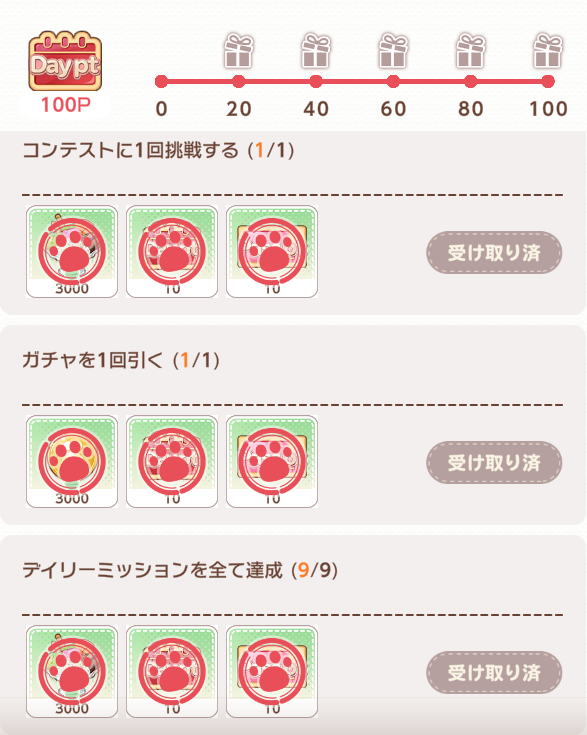

# 每日独立模块与命令行

## 当前方向与边界

2026-10-20 本轮将旧「每日任务：免费优先」总入口拆成独立玩法模块，在 [interface.json](../../../assets/interface.json) 的任务列表中由用户选择、排序，领奖放最后。业务共享判页及安全收尾适配位于 [daily_core.json](../../../assets/resource/pipeline/daily_core.json)，已知页面归首页由 [navigation.json](../../../assets/resource/pipeline/navigation.json) 统一执行，各玩法由独立 `daily_*.json` 执行；[delivery.py](../../../agent/delivery.py) 仅汇总原生地图识别、保存当前 pin 并核验派出状态，[run_daily.py](../../../tools/run_daily.py) 只负责显式顺序调用、审计和报告，不替代 JSON 游戏流程。

**本轮模块是用户主动选择的操作，不再按每日列表 `0/1` 筛掉已选择的模块。** 即使账号已 `9/9`，选择 VR、比赛、配送、礼物或交换仍可能实际消耗免费次数或游戏资源。任务执行结束、回到首页、MaaFramework job 成功，不等于每日条件、全部邮件或所有订单已完成。

目标始终为 `127.0.0.1:5557`，不提供设备回退。游戏事实来源为 2026-10-19 至 20 日、2.2.0 / JP2、日文 720 x 1280 的[人工研究](daily_tasks_research.md)与本机截图；刷新时刻由用户提供为东京 00:00 / 北京 23:00，各玩法独立额度仍按当前游戏画面读取。

当前共 12 个独立模块：九项每日条件对应的玩法/登录，加邮箱、社团和领奖。下表记录本轮新的行为要求及实现契约。独立模块拆分后的实机证据需另行补充，不能把改造前的成功记录当作全部新路径已验收。

## 模块选择

Interface 及各 pipeline 入口的 `doc` 统一使用操作名称，例如“VR猫爬塔”“交换所兑换”，不把金额、次数或每日完成条件写进名称；具体限制仍保留在说明和消费 Gate 中。英文入口 ID、CLI 名称和执行行为不变。“框架测试”已从正式任务列表与资源中移除；独立启动截图脚本仅在显式运行时注入自己的诊断流程，不属于用户任务。

| CLI 名称 | 独立入口 | 本轮行为与限制 |
| --- | --- | --- |
| `login` | `DailyLogin_Start` | 游戏未在前台时由原生 `StartApp` 启动或切回，已在前台则不重复启动；等待已知游戏 UI 后经 `NavHome_Ensure` 登录、回首页并清理提示。不先停止游戏，不执行玩法或每日列表领奖。游戏已开时不是其他模块的必选前置。 |
| `income` | `DailyIncome_Start` | 领取一次普通营业收入；不点追加收入，不默认花钻石。 |
| `friend` | `DailyFriend_Start` | 现有好友页一键问候，批量按钮最多点击一次；不处理好友申请，不新增或删除好友。早期人工只问候一人不是当前模块行为。 |
| `delivery` | `DailyDelivery_Start` | 先批量领取已完成订单，再逐 pin 自动编队派出；确认本批全部已派出后，至多一次每日免费更新，再派新单。正向识别电池图标及 `1000/2500/5000/10000` 白名单，每单上限 `10000`、本次最多 36 单；地图计数不完整或派出未确认即停，不花钻石更新或加速。 |
| `gift` | `DailyGift_Start` | 直接由 Quest 进入礼物关卡，不看每日进度；最多六次滑动后必须确认滚动条到底，再从下往上最多八次重叠搜索已通关爪印。最低可见标记须有完整同行备战按钮，再正向确认快速开店勾选，至多消费一次；未知底部、余量或勾选状态不执行，不用钻石补次数。 |
| `vr` | `DailyVR_Start` | 每次精确读取剩余免费次数 `N`，跳过并领奖后必须正向确认恰好为 `N-1` 才继续，目标为用尽免费次数；每 Task 最多九次。计数不变、跳变、增大或缺失即停，不重放、不买次数，也不用已完成每日条件屏蔽本模块。 |
| `contest` | `DailyContest_Start` | 一次免费挑战，复用现有编队；不付费刷新、补次数或自动重赛。 |
| `exchange` | `DailyExchange_Start` | 随机交换所的一份 `1000` 金币商品；不回退好友币或钻石商品，不付费刷新。选择该模块本身包含这一次资源操作。 |
| `gacha` | `DailyGacha_Start` | 广告免费抽卡与广告关闭单独受控；不是钻石、抽卡券单抽。关闭广告不等于已抽到卡，须正向确认游戏结果。 |
| `mail` | `DailyMail_Start` | 批量领取最多一次；容量不足必须停止领取并报告受限，不能反复点批量领取。 |
| `guild` | `DailyGuild_Start` | 问候与帮助各一次；金币赞助为可选项，默认关闭，授权上限为每次 `1000` 金币、最多十次。CLI 当前不额外开启赞助。 |
| `rewards` | `DailyRewards_Start` | 在最后领取已达标每日、汇总及阶段奖励；每次结果后重新判页、重扫列表。未选择则不隐式追加。 |

界面任务配置、默认值与具体次数 Gate 以本次加载的资源为准；尚在改造的模块不得仅靠本表宣称完成实机验收。选择会派单、快速开店或交换的模块前，应核对当前资源状态和上次消费结果。

### 配送收敛条件

[daily_delivery.json](../../../assets/resource/pipeline/daily_delivery.json) 控制批量领取、自动编队、派单和免费刷新；`DailyDeliveryMapProbe` 在当前 Task 的 Context 中保存一个选中 pin，只汇总原生模板/OCR 结果，不执行点击或另建业务调度器。`OrderCount` 必须完整读为 `0/18` 至 `18/18`，且去重后的可见订单 pin 数必须与它一致；未知、互相矛盾或漏识别的标记均停止，不能以“没有识别到待派单”推断全部已派出。

每单须有电池图标、白名单成本和可用配达按钮，消费节点最多 36 次，`10000` 是每单上限而非本批总电池上限。点击一次配达后等待同一个 pin 出现倒计时或完成状态，再选择下一单；仅回地图或暂时仍在备战页不是派出成功，不再点击消费按钮补发。所有可见订单均已启动后才允许一次正向免费更新确认，再核对刷新后的地图及已变为 `100` 钻石的付费刷新按钮；该按钮只识别、不点击。地图核对失败、未知订单或消费后状态未确认时，不刷新来丢弃问题订单，也不存在钻石立即完成路径。

VR 的次数证明由纯 JSON 的 `DailyVR_ReadN` 与 `DailyVR_VerifyN` 完成：本次先精确读取 `1` 至 `9`，绑定唯一预期余量后才进入共同消费节点；结果领取后只接受这次预期的 `N-1`，不能自由重新选择更大读数。降到零正常返回，未知初始额度另报不可确认；已经尝试一次后计数不变、跳减、增加或缺失均截图停止，不因仍能识别免费按钮而再试。此递减约束为本轮末新增安全修复，离线定向测试通过，尚未实机验收。

### 排序与停止

CLI 要求 `--tasks` 后明确给出顺序列表；不指定任务也不使用 `--inspect-only` 时直接报错，不再默认运行一组“免费任务”。同一名称不能重复，不同别名也不能指向同一入口重复执行，未知名称在连接设备前拒绝。

普通模块保持用户顺序。若显式选择 `rewards`，CLI 把它移到列表末尾；不自动插入其他模块。每个独立入口只调用一次，执行异常、停止、超时或缺少可信收尾节点时，不重试当前项，剩余项标为 `not_run`。明确的零免费次数、无法确认额度或邮件容量受限若已安全回首页，可报告受限并继续后续选中模块，不自动补做该项。

`login` 可单独选择或放在所选序列开头，CLI 不隐式追加或强制前置；后续每个模块仍自行调用公共导航，不能依赖此前已经运行登录模块。登录只清理登录奖励/公告，不等于领取日常列表中的登录条件奖励，后者属于显式选择的 `rewards`。

### 登录条件启动

`DailyLogin_Start` 先通过 [login.py](../../../agent/login.py) 的 `DailyLoginAppState`，使用当前已绑定的 Maa 控制器只读执行 `dumpsys activity activities`，不另建 ADB 连接、不选设备或调用主机 shell。只接受一致的 `topResumedActivity` / `mResumedActivity` / `ResumedActivity` 包名，不从历史 Activity 中猜前台。游戏已在前台时直接等待已知 UI；确认前台为其他应用时，原生 `DailyLogin_Launch` 对精确游戏包调用 `StartApp`，每 Task 最多一次，不调用 `StopApp`。这既涵盖已退出后的冷启动，也涵盖从后台切回。

每次系统查询上限三秒，并检查返回状态与取消；未知、失败、歧义或不支持的控制器不能放行启动。初始状态扫描上限十秒，启动后等游戏成为前台上限四十五秒，之后 `DailyLogin_WaitUi` 最多一百二十秒只等待已知页面，再交公共导航。这个额外等待修复了实机冷启动白色 Loading 超过原三十秒导航窗口的问题：未知启动画面只等，不盲点、不中途强制重启。异常发生时仍由既有公共恢复处理，不新增重启预算。

CLI 对登录有一个限定例外：标题登录复用公共恢复后，只有轨迹最后正向命中 `DailyCore_Done`、没有 `CommonStopGame`、没有消费节点或消费尝试，才报告 `finished` 并设置 `login_recovered_to_home=true`，允许后续选中任务继续。底层 job 失败、超时、停止仍优先；其他业务的 `recovered_unverified` 不放宽，`game_completion` 仍为 `unverified`，不把到首页当作每日条件完成。

独立模块分别是 MaaFramework Task，次数许可主要在各 Task 内生效，不是跨进程的持久账号预算。CLI 防止本次列表重复，不保证人为反复启动命令时共享消费次数。不要用重启进程、新建 Task 或重跑失败命令来刷新预算；消费结果不确定时先核对游戏状态和审计记录。

### 登录启动本轮验证

2026-10-20，同一获准设备 `127.0.0.1:5557`、游戏 2.2.0 / JP2，先补桌面启动失败测试，再实现条件启动；随后补标题登录成功仍被 CLI 停批、白色 Loading 超过旧导航窗口的两项红测，分别修正限定的登录收尾判定与启动等待。正常启动链不含 `StopApp`，游戏已在前台时没有 `DailyLogin_Launch`。

| 状态与执行顺序 | 本次实际证据 |
| --- | --- |
| 游戏仍运行但位于桌面，MPE 登录→好友→邮箱 | 游戏进程 `4325 / 4440` 前后不变，证明切回未重启；该批最后出现会话/网络中断，不能凭 MPE `3/3` 记作全部正常完成。随后审计轨迹确认网络返回标题并重新登录，没有 `CommonStopGame`。 |
| 游戏进程已退出，从桌面登录→邮箱→好友 | 通过 Android 最近任务只划掉游戏卡片，启动前 `pidof` 无输出；最终[冷启动报告](images/daily_tasks/login_cold_serial_report.json) 为三项 `finished`，登录只有一次 `DailyLogin_Launch`，经过 `DailyLogin_WaitUi` 和标题登录再正向到首页；没有 `CommonStopGame` 或消费尝试。没有使用 force-stop、清数据或重启模拟器。 |
| 游戏已在前台，登录→好友→邮箱 | [已打开报告](images/daily_tasks/login_open_serial_report.json) 三项均 `finished`；登录直接通过 `DailyLogin_Foreground` / `DailyLogin_WaitUi`，没有启动节点。进程 `6542 / 6659` 前后不变，无 `CommonStopGame` 或消费尝试。 |

冷启动报告原目录为 `20261020T053705Z_1792474625063398100`，已打开报告为 `20261020T054339Z_1792475019422924700`。两份 JSON 原样保留字段，仅规范 LF；[冷启动串行后首页](images/daily_tasks/login_cold_serial_home.png) 是本次真实设备截图，不是历史截图或离线合成。邮箱路径只确认正常退出，没有批量领取节点，不宣称七封受容量限制的邮件全领；好友本次无可问候目标，走正常无目标收尾。阶段失败仍保留在本机 `debug/daily-runs/`，没有覆盖成成功。

最终全套离线为 **638 passed、2 skipped**，耗时 405.50 秒；跳过仍为 Windows junction 创建权限限制。`compileall`、全部资源/接口 Schema 通过。登录测试独立为 `test_daily_login.py`，覆盖真实控制器模拟、一次启动、已打开不重启、长启动过场、标题登录后继续下一任务、未知/歧义/失败查询、取消及不隐藏重启/消费；没有向生产 Python 安装测试依赖。

MPE 在停止阶段出现旧控制器释放/断开超时，随后实时截图失败；本次最终冷启动和已打开的完整成功证据均来自相同资源的 CLI 审计入口，不把 MPE 的旧完成数当成功证据。2026-10-20 经用户确认，仅正常停止并隐藏重启本项目 LocalBridge，沿用原配置及 `ws://127.0.0.1:9066`；MPE 重连 `127.0.0.1:5557` 后已恢复实时首页画面和准备就绪状态，原任务勾选、顺序保留。游戏进程重启前后同为 `6542 / 6659`，未重启游戏或模拟器，也未执行选中的任务。此次连接恢复不等同重新完成 MPE 冷启动串行验收，不改变上述设备端成功轨迹。

## CLI 用法

从仓库根目录运行，生产入口使用项目私有 Python，不依赖全局 Python、Conda 或系统 `PATH`：

```powershell
# 仅打开、选择每日并扫描，不领每日/阶段奖励、不执行玩法。
& .\.runtime\python\python.exe tools/run_daily.py --adb-path '<实际 adb.exe 绝对路径>' --inspect-only

# 必要时启动/切回游戏，再登录到首页并清理提示，不执行玩法或每日列表领奖。
& .\.runtime\python\python.exe tools/run_daily.py --adb-path '<实际 adb.exe 绝对路径>' --tasks login

# 明确只做普通收入和好友问候，再领奖。
& .\.runtime\python\python.exe tools/run_daily.py --adb-path '<实际 adb.exe 绝对路径>' --tasks income friend rewards

# 按所列顺序各执行一次；免费额度仍由运行中的实际画面核对。
& .\.runtime\python\python.exe tools/run_daily.py --adb-path '<实际 adb.exe 绝对路径>' --tasks vr contest rewards --timeout 600
```

`--inspect-only` 仍兼容旧 `Daily_Start` 扫描入口，并覆盖禁用旧玩法、每日领奖和阶段领奖，不能与 `--tasks` 混用。它只读当前任务进度，不代表其他模块已经执行；公共导航若需要重新登录，仍可能自动取得登录奖励，不能声称账号状态绝对不变。旧总入口仅作兼容，不再作为主任务列表的组合执行器。

旧 `--gold`、`--new-delivery`、`--gift`、`--locate-ad` 明确报弃用错误，分别提示迁移到 `--tasks exchange`、`--tasks delivery`、`--tasks gift`、`--tasks gacha`。这不是静默同义替换：例如新版配送包含本轮新授权的派单/免费更新流程，广告模块也不应再被理解成永远只定位横幅。

`--timeout` 是整批所选模块共用的执行期限，范围 30 至 1800 秒，默认 600 秒，不是每项重置的独立时长。OCR 预检在设备连接前完成；资源加载和控制器连接分别有 30 秒轮询上限。超时或 Ctrl+C 后请求停止，等待停止确认最多五秒；不保证撤销已经发出的服务端动作或硬中断底层原生调用。CLI 不会因模块失败而新建 Task、重连或重启整批来补做分项；模块内部消费前的公共恢复仍在同一 Task 内有界执行，不重置消费许可。

### 报告与退出码

CLI 输出 JSON，并保留最新 `debug/daily_report.json` 和不覆盖的 `debug/daily-runs/<UTC时间与唯一后缀>/report.json`。每个已执行模块在开始下一项前归档本次新生成的截图，使用序号和模块名前缀，避免后一个模块覆盖前一个模块的证据；旧截图不复用。

报告包含请求选项、实际任务顺序、入口、各项节点序列、Maa job 状态、`Spend` 动作开始事件和产物路径；不写入模型 API 密钥。`attempted` 即使在动作失败、没有完成节点时仍保留，代表已尝试，不代表服务器接受。未知消费结果不可重放。

| 状态 | 含义 |
| --- | --- |
| `finished` | 已识别模块收尾节点，仅表示流程执行结束；`game_completion` 仍为 `unverified`。 |
| `complete` | 仅在旧扫描/领奖路径留下 `Daily_CompleteHome` 正向证据时，报告每日整体完成。 |
| `partial` | 每日尚未全部完成，或本批存在受限结果；不能当作需要自动重跑的信号。 |
| `exhausted` | VR 或礼物次数明确为零，正常安全返回；整批可正常结束，不因此自动重试或买次数。 |
| `unavailable` | 无法确认 VR 免费额度，或广告未启动；不是零次。广告启动失败即使已经安全返回也不再重试。 |
| `free_quota_consumed` | 广告免费额度确已消耗，但没有抽卡结果页证据；不宣称抽卡成功或日常达标。 |
| `capacity_limited` | 邮件容量不足，仍有未领取邮件，不宣称“全领”。 |
| `recovered_unverified` | 经恢复回到首页，但所选业务未确认；停止剩余模块，不把恢复成功当业务成功。 |
| `stopped` / `timeout` / `interrupted` | 本项未正常完成，后续选择项不再启动。 |
| `not_run` | 前项停止后未调用该入口；不是跳过了已完成条件。 |

退出码 `0` 表示所选模块安全结束、免费次数正常耗尽、仅确认广告额度消耗或已正向确认每日完成，不保证每项游戏条件达标；`2` 表示部分、不可用、邮件容量受限、业务未确认的恢复、停止或超时。参数错误为 `2`，初始化失败非零。判断每日全部完成还需结合 `game_completion` 和实际领奖/扫描证据，不能只看退出码或 job 成功。

OCR 模型要求 `assets/resource/model/ocr/{det.onnx,rec.onnx,keys.txt}` 均已准备且非空；缺失即停，不自动下载。发布客户端也须携带模型。开发测试使用独立环境，不能向生产 `.runtime/python` 安装 pytest。

## 广告关闭与可选模型

[ad_close.py](../../../agent/ad_close.py) 提供有界广告关闭扩展，CLI 与 Agent 均需注册。本地 SDK 关闭识别入口预留，但当前没有真实 SDK 关闭控件素材，保持禁用，不能声称默认已经能识别广告 X。广告播放、原生关闭控件与游戏抽卡结果的完整实机闭环仍需对应 SDK 画面验证。任何广告内安装、购买、领奖诱导或“下一步”都不是关闭许可。

可选视觉 provider **默认禁用，未配置不外发图像**。只有显式设置下列配置才会允许模型请求，不读取或假定用户已经安装 AI 助手、插件、密钥或服务：

| 环境变量 | 约束 |
| --- | --- |
| `MAANEKO_AD_LLM_ENABLED` | 必须显式为 `1` 才启用；未设置或其他值均不启用。 |
| `MAANEKO_AD_LLM_ENDPOINT` | 用户自行指定的 `/chat/completions` 地址；只允许 HTTPS，或仅回环地址的 HTTP。 |
| `MAANEKO_AD_LLM_MODEL` | 用户指定的支持所需图像输入与 JSON 响应的模型，不提供默认外部模型。 |
| `MAANEKO_AD_LLM_API_KEY` | 用户自行提供；不写入仓库、文档示例或 CLI 报告。 |

请求仅含四个角各 128 x 128 的拼接图，不上传完整屏幕；角落仍可能含广告、文字或其他信息，启用前由用户确认 provider 与外发范围。请求禁止代理自动继承和重定向，采用八秒 I/O 超时与响应截止检查，不保证硬中断 DNS 解析或底层网络调用；每 Task 最多 40 次广告检查、四次模型请求、三次关闭点击。模型仅可答 `close`、`wait` 或 `unknown`；关闭框必须在角落内且满足严格置信度、尺寸约束，点击前还会重新截图核对，无法确认就停止，不让模型执行任意游戏操作。

这是已提供的可选代码接口，不代表本机已配置或已成功调用任何模型 API；本轮未用密钥或真实外部 provider 验收。广告关闭成功也不证明广告奖励或抽卡已到账，必须再识别游戏结果，不能失败后重触发广告抽取。

## 验证记录

### 改造前的实机证据

拆分前的实验总入口承接人工/手机已完成的八项，自动补做一次 `1000` 金币商品、领取交换与汇总奖励及阶段礼物，最终确认 `9/9`、`100 DayPt`。随后再次运行时消费尝试为零。它证明旧“读取未完成每日再调度”路径在当时账号下的结果，不证明新版独立入口在 `9/9` 时应该跳过所选模块。



旧报告保留在已忽略的 `debug/`，包括 `daily_gold_success_report.json`、`daily_weekly_timeout_report.json`、`daily_inspect_report.json` 和 CLI 历史目录。原始研究中的 `8/9` 是更早时段，不覆盖成当时已全完成。旧总入口的礼物战斗、新派送和广告 SDK 闭环未因此获得验收。

### 本轮独立模块证据

先补 CLI 失败测试，再实现显式顺序、去重、领奖末置、停止余项、审计与有限等待；独立测试环境 `config/test-python/Scripts/python.exe` 下，`tests/test_run_daily.py` 补充恢复未确认、广告不可用、次数耗尽的报告回归后曾为 **39 passed**，当时文件 195 行。这是独立登录入口新增前的阶段结果，不是本轮最终全套结果。默认临时目录权限受限，测试使用工作区已忽略的 `--basetemp config/...`，不解除离线设备/网络隔离。

邮件人工观测为打开信箱后批量领取一次、出现奖励、再遇容量不足，退出后仍有七封；对应 `daily_20261019_163_mail.png`、`daily_20261019_164_mail_batch.png`、`daily_20261019_165_mail_result.png`、`daily_20261019_166_mail_left.png`、`daily_20261019_167_mail_exit1.png`。不把“点了批量领取”说成全清；模块用容量受限 trace 与正常收尾分开报告。

广告人工观测：`daily_20261019_185_gacha_ad.png` 显示免费剩一次，`186_gacha_ad_start` 出现确认；点击确认中的观看按钮后，`187_ad_playing` 实际仍是卡池横幅、免费仍一次。再等待约一分钟，`188_ad_wait` 仍未出现 SDK 画面，也未扣免费次数。文件名里的 `playing` 不证明已经播放。记录为广告启动失败/无填充原因未确认，没有重试，不能记抽卡成功，也没有实际 SDK 关闭素材或模型 API 调用证据。

礼物人工观测：`daily_20261019_191_gift.png`、`192_gift_bottom` 显示本账号列表底部三至六号店已领取初回奖励，继续上滑不动。`193_gift_prepare6` 已勾选快速开店，现有评价 `5388K` 对敌方约 `486K`；手动点一次开店后，`194_gift_quick_result` 直接 Win，点击主 OK 返回，未点右侧「もう一度挑戦」。`195_gift_done` 为 `0/3`。这是一次已授权人工快速开店胜利，不是新自动链的非零次数实机验收。

礼物实现先补失败回归，再改独立 Quest 路由、到底确认和通用已通关标记选择；标记包原生 And 输出单个选中框，避免相对 ROI 遍历全部 `filtered` 而错点上方关卡。新增到底后上搜、旧 ROI 缓存与有限搜索回归后，礼物原生离线 **22 项通过**；覆盖最低标记同行、该行按钮变暗/缺失不能借上行授权、零次与未知区分、勾选复核、一次消费、Win+OK及不重复挑战。礼物、旧每日、共享核心与 CLI 的组合回归 **117 passed**，统一引用检查三项通过、完整 Schema 与 `compileall` 通过。测试文件 199 行。新自动入口在本日零次时的实机判页仍待验收，六次滑动仍未确认到底或八次上搜仍无目标时保守停止。

礼物底部可见行没有已通关标记时，只有先前在本次入口内正向证明到底，才允许向上重叠搜索。独立入口显式将搜索证明锚点置为 `NoProof`，到底后再设置许可；不能凭 MaaFramework 跨 Task 保留的旧 ROI 识别缓存放行普通中段，也不重置消费预算。每步约移动 400 像素并保留可见区重叠，最多八次；一旦发现最低可见已通关标记，但同行按钮缺失、变暗或裁切不完整，就停止，不能越过它继续找更低目标。搜索预算耗尽仍无可用目标时同样停止，不宣称任意账号进度或任意长列表都已覆盖。首轮独立只读安全复核未发现消费重放或误点再挑战问题，后加上搜仍以原生回归和后续实机为准。

### 配送人工证据

`daily_20261019_199_map.png` 至 `daily_20261019_201_map_collected.png`：本轮手动批量领取六份旧配送，奖励画面数量依次为 `410000`、`410`、`82`、`34`、`360`，最后一项为钻石；领取后地图计数为 `0/18`。这些是旧订单奖励，不是本轮新派单的完成奖励。

`daily_20261019_202_delivery_refresh.png` 的确认明确写免费，钻石由 `13550` 到 `13550` 不变；`daily_20261019_203_delivery_refreshed.png` 出现六个新订单，刷新按钮改为 `100` 钻石。`daily_20261019_204_delivery_prepare.png`、`daily_20261019_205_delivery_auto.png` 为蓝色订单与自动编队，配达成本 `1000` 电池。点击一次后，`daily_20261019_206_delivery_sent.png` 仍短暂处于备战页，直到 `daily_20261019_207_delivery_map_after.png` 同 pin 出现 `05:48:28` 倒计时才确认已派出；后一张 `daily_20261019_208_delivery_orange.png` 的电池为 `998999`，较派出前减少 `1000`。

橙色订单在 `daily_20261019_208_delivery_orange.png` 显示 `2500` 电池但未派出；紫色订单 `daily_20261019_211_delivery_purple.png` 成本 `10000`，`daily_20261019_212_delivery_autopurple.png` 自动编队后四个条件均满足，也未派出。本轮人工只验证一份新单及一次免费更新，不证明 36 单循环、全部成本档位或独立配送入口已完成自动实机验收。文件名日期为会话前缀，不代表每张截图的拍摄日。

### 首次自动批次阻断

本轮新入口首次执行顺序为 `friend vr gift rewards`，报告 `debug/daily-runs/20261020T030554Z_1792465554653274900/report.json` 最终为 `stopped`，`game_completion` 为 `unverified`、`attempted` 为空；首项未完成，后三项均为 `not_run`。虽然底层 `job_succeeded` 为真，CLI 没有将恢复停止误报成好友完成，也没有继续尝试 VR、礼物或领奖，因此礼物零次入口的自动实机验收仍未执行。

故障原图 `debug/on_error/2026.10.20-11.06.24.427_Daily_FriendMenu.png` 为「ログインに失敗しました / サーバーへの接続に失敗しました / ゲームを終了します」，不是好友菜单模板不匹配。弹窗覆盖了底层 Close，当时通用关闭误处理该提示；后续有界恢复重启仍停在启动器。`daily_20261019_214_current.png`、`daily_20261019_215_launch_game.png`、`daily_20261019_216_after_explicit_start.png` 显示随后启动仍未进入游戏，没有取得 crashlog，原因未确认。已停止实机，不反复启动来重试任务。

已为此新增严格标题、退出正文与 OK 识别，导航和公共恢复先于通用 Close 处理；确认最多一次，后续复用原有最多两次重启预算，不清零也不重放所选业务。新增误点复现及分支的定向离线测试已通过，但修复后未做实机验证，不能宣称登录问题已经解决。

独立配送全循环、好友一键、VR 用尽免费、礼物零次判页、广告关闭/抽卡、邮件及工会的完整自动结果仍待验收；本文不把人工观察或资料编辑当作自动设备验收。全套 Schema、回归和最终新截图须以本次实际结果更新，不能引用旧 `409 passed` 当作重构后验证。跨语言、分辨率、不同关卡、广告 SDK、好友与邮件状态、订单条件以及各玩法刷新规则仍有边界。

### 本轮最终离线复验

2026-10-20，在加入独立登录入口、VR 严格减一确认、登录失败专用恢复，以及配送完整地图/亮度门禁后，使用独立开发环境执行完整测试：**585 passed、2 skipped**，耗时 285.10 秒。两项跳过均为 `tests/test_portable_python.py:154` 的 Windows junction 创建被系统拒绝（`WinError 5`），不是 OCR 缺失。`compileall`、全部资源及接口 Schema、统一节点/图片引用、测试文件不超过 200 个物理行、UTF-8/LF 与 `git diff --check` 均通过。测试仍隔离真实 ADB、网络和进程，不把离线通过视作上述未完成实机路径已经验收；没有提交、推送或同步已安装客户端，客户端使用前需停止任务并重载源资源。

### 串行衔接修复与 MPE 验证

2026-10-20 用户反馈单项正常、interface 多项串行会因残留页面卡住。旧 `NavHome_Ensure` 只认识首页、咖啡店和强化页；`Daily_Return` 另有独立返回循环，点击无效时可反复扫描原页面。现在入口和收尾共用纯导航 `NavHome_Normalize`，每次重新绑定私有返回点，Home 点击后只等待首页确认，不重放业务。支持的页面、弹窗、超时与共享预算见[导航契约](navigation.md)；未知页面、战斗和 SDK 广告不属于通用 Home/Close 许可。

本机 MPE 2.1.0 经现有独立 LocalBridge 加载仓库真实资源，手动明确连接 `127.0.0.1:5557`，未使用自动发现的其他地址。初始游戏停在配送地图。第一批 UI 虽显示五项已完成，实际停在社团根页；额外 CLI 轨迹 `20261020T043211Z_1792470731856281500/report.json` 明确为停止，不是成功。原社团标题 ROI 裁掉一部分爪印后，原生 OCR 再次识别可读成 `・サークル`，未通过原有精确标题门禁。新增保留完整爪印的独立 UI 夹具，连续两次识别及 Gate→动作均先红后绿；根页 ROI 改为 `[0,20,300,80]`，成员页为 `[0,20,210,80]`，保留精确正则及 `0.95` 阈值，不放宽识别。随后单独从社团页执行登录任务的轨迹 `20261020T043706Z_1792471026295229700/report.json` 正向通过 Home→`DailyCore_Done`，没有消费尝试。

修正后在浏览器 interface 实际执行两组五项，均显示 `5/5`，并逐次截图确认最终确为首页，而不是只看绿色任务状态：

| 批次 | 选择的实际顺序 | 导航结果 |
| --- | --- | --- |
| 正向 | 登录 → 普通收入 → 好友 → 社团 → 邮箱 | 五项结束，最终首页，见[正向证据](images/daily_tasks/mpe_serial_forward_20261020.png) |
| 倒序 | 邮箱 → 社团 → 好友 → 普通收入 → 登录 | 五项结束，最终首页，见[倒序证据](images/daily_tasks/mpe_serial_reverse_20261020.png) |

这两批仅选择上述免费模块，调试时关闭金币赞助，不运行家具强化、配送派单、VR、礼物、比赛、交换或广告。结束后已恢复浏览器原有任务顺序、勾选（登录、配送、家具）和用户已有的赞助开关，保持停止，没有运行恢复后的消费任务。

**MPE 的“已完成”不是每项业务成功。** 额外 CLI 顺序 `mail guild friend income login` 的 `20261020T044555Z_1792471555411889300/report.json` 中，邮箱正向回首页；社团批量问候点击一次后未出现奖励，停在成员页，CLI 正确保留 `stopped` 并将余项标 `not_run`，没有重试问候。随后从该成员页执行 `login friend income` 的 `20261020T044851Z_1792471731623233800/report.json`：登录经新导航返回首页；好友无可问候目标，关闭好友和菜单后正向收尾；收入未确认入口，经公共恢复回首页，报告 `recovered_unverified`。上述所有报告 `attempted` 为空，不宣称社团问候或营业收入已到账。MPE 两组测试证明这些残留已知页面不再阻断下一项导航，不证明所有业务条件、十二项全部实机完成或全部排列均已实机验收。

对应原生离线回归在同一 Tasker 上按正反序连续调用十二个日常入口，从各类真实 UI 夹具归首页后仅抵达本次选择的业务；消费业务处设置哨兵终点，不执行消费。另有 Quest/地图→真实家具调度入口→Soleil，以及下一任务从咖啡店/强化末页归首页的两例。未知/暗帧/footer-only 不点击、无效 Home 只点一次、旧 caller 兼容、弹窗共享限额、跨 Task 返回点隔离均有回归。最终完整测试 **606 passed、2 skipped**，耗时 410.27 秒；跳过仍为上述 Windows junction 权限限制。`compileall`、全资源及接口 Schema、统一引用及测试行数检查通过；不以离线哨兵测试替代未执行的真实资源消费流程。
