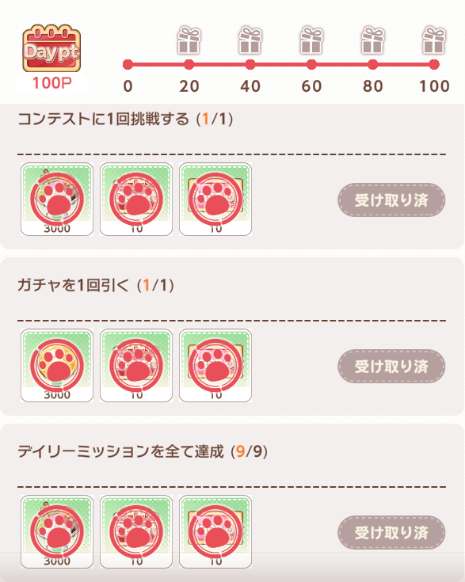

# 每日任务与 Soleil

## 当前方向与边界

2026-10-20 本轮将旧「每日任务：免费优先」总入口拆成独立玩法模块，在 [interface.json](../../../assets/interface.json) 的任务列表中由用户选择、排序，领奖放最后。业务共享判页及安全收尾适配位于 [daily_core.json](../../../assets/resource/pipeline/daily_core.json)，已知页面归首页由 [navigation.json](../../../assets/resource/pipeline/navigation.json) 统一执行，各玩法由独立 `daily_*.json` 执行；[delivery.py](../../../agent/delivery.py) 仅汇总原生地图识别、保存当前 pin 并核验派出状态。

按用户要求，旧 `daily.json` 总流程及每日业务 CLI 已删除，不保留进度扫描兼容入口或另一套命令行任务编排。本文中的旧 CLI 报告与退出状态只用于解释已保存的历史证据，不代表当前仍支持该工具。

**本轮模块是用户主动选择的操作，不再按每日列表 `0/1` 筛掉已选择的模块。** 即使账号已 `9/9`，选择 VR、比赛、配送、礼物或交换仍可能实际消耗免费次数或游戏资源。任务执行结束、回到首页、MaaFramework job 成功，不等于每日条件、全部邮件或所有订单已完成。

目标始终为 `127.0.0.1:5557`，不提供设备回退。游戏事实来源为 2026-10-19 至 20 日、2.2.0 / JP2、日文 720 x 1280 的[人工研究](daily_tasks_research.md)与本机截图；刷新时刻由用户提供为东京 00:00 / 北京 23:00，各玩法独立额度仍按当前游戏画面读取。

2026-10-21 任务列表整理为 12 个入口：11 个其他每日模块，加一个 `Soleil`。Soleil 的复选框包含配送、浴室收菜、当番换班和家具升级，默认勾选前三项。家具原有排序、筛选、依頼、轮数及间隔配置均保留，勾选家具升级后显示；配送原内部入口仍用于业务复用。

## 模块选择

Interface 及各 pipeline 入口的 `doc` 统一使用操作名称，例如“VR猫爬塔”“交换所兑换”，不把金额、次数或每日完成条件写进名称；具体限制仍保留在说明和消费 Gate 中。“框架测试”已从正式任务列表与资源中移除；独立启动截图脚本仅在显式运行时注入自己的诊断流程，不属于用户任务。

| 模块 | 独立入口 | 本轮行为与限制 |
| --- | --- | --- |
| 登录 | `DailyLogin_Start` | 游戏未在前台时由原生 `StartApp` 启动或切回，已在前台则不重复启动；检测到 `TAP TO START` 即点击，不再等待启动后固定延迟或标题 Logo。继续确认首页并清理提示；未知画面仍有等待上限，不先停止游戏。 |
| 普通收入 | `DailyIncome_Start` | 领取一次普通营业收入；不点追加收入，不默认花钻石。 |
| 好友 | `DailyFriend_Start` | 现有好友页一键问候，批量按钮最多点击一次；不处理好友申请，不新增或删除好友。早期人工只问候一人不是当前模块行为。 |
| Soleil / 配送 | `DailyDelivery_Start`（内部） | 批量领取已完成订单，再自动编队派出待派订单，派出后只读取总览倒计时。优先处理一次每日免费更新；可选追加一次 100 钻更新，默认关闭，要求可见订单非空且全部正在配送。默认最多 36 单，开启付费更新后最多 54 单，每单成本为 `1000/2500/5000/10000` 电池。不使用配達加速或立即完成。 |
| 礼物 | `DailyGift_Start` | 左右栏分别设置快速开店次数，默认各三次，以各栏当前剩余免费次数为限；每次消费后须确认结果和次数减一再继续。沿用最高已通关关卡搜索和快速开店勾选门禁；不购买次数、不重放未确认消费。 |
| VR | `DailyVR_Start` | 每次精确读取剩余免费次数 `N`，跳过并领奖后必须正向确认恰好为 `N-1` 才继续；最后一次允许正向确认免费气泡消失后只返回。每 Task 最多九次，其他计数异常即停，不重放、不买次数，也不用已完成每日条件屏蔽本模块。 |
| 比赛 | `DailyContest_Start` | 一次免费挑战，复用现有编队；对手可选上/中/下，默认上栏。首位评分阈值默认为 `0`（不筛选），正数时在评分不小于阈值时用免费更新，直到评分小于阈值或免费次数耗尽；每次检查刷新余数减一。不付费刷新、补次数或自动重赛。 |
| 交换所 | `DailyExchange_Start` | 可购买当前页最多四种金币商品（每种一份），或用尽当日免费更新并处理每页。不购买其他货币商品，不进行付费刷新；金币商品与数量须在确认框再次核对。 |
| 广告抽卡 | `DailyGacha_Start` | 广告免费抽卡与广告关闭单独受控；不是钻石、抽卡券单抽。关闭广告不等于已抽到卡，须正向确认游戏结果。 |
| 邮箱 | `DailyMail_Start` | 批量领取最多一次；容量不足必须停止领取并报告受限，不能反复点批量领取。 |
| 社团 | `DailyGuild_Start` | 问候与帮助各一次；金币赞助为可选项，默认关闭，授权上限为每次 `1000` 金币、最多十次。 |
| 领奖 | `DailyRewards_Start` | 在最后领取已达标每日、汇总及阶段奖励；每次结果后重新判页、重扫列表。未选择则不隐式追加。 |
| Soleil | `Soleil_DailyStart` | 按复选框依次执行配送、浴室、当番、家具。浴室在换班前，家具在最后；每个子业务只调用一次，子业务中的既有循环配置保留。浴室最多两名并记录鸭子增量，当番点击 `おまかせ`。全不选时只返回首页。 |

界面任务配置、默认值与具体次数 Gate 以本次加载的资源为准；尚在改造的模块不得仅靠本表宣称完成实机验收。选择会派单、快速开店或交换的模块前，应核对当前资源状态和上次消费结果。

### 运行日志

入口、关键操作、结果和异常使用 Pipeline `focus` 的 `Node.Action.Succeeded` / `Node.Action.Failed` 消息。日志只保留简短操作、数值和失败原因，例如“[配送] 订单已开始”“[浴室] 鸭子+3”。普通候选未命中不逐帧输出，已删除重复的防御性说明。

配送分类、领取钻石、家具等级和最大耗时尚未识别时，直接输出对应字段“未识别”。鸭子增量、原有订单核对、免费次数和倒计时使用实际识别结果。客户端使用前停止任务、重启 Agent 并重载资源。

浴室每次点击前以原生模板确认顶部鸭子图标，再用原生 OCR 读取当前余额。领取后仍须先确认入浴次数恰好减一及原角色标记消失，最多等待 3.5 秒重新读取结果；前后余额差为 `1..10` 才输出单次 `鸭子 +N`、前后读数和本任务已确认累计。单次随机 `1..10` 是用户于 2026-10-21 提供的规则，不代表本次采样已覆盖全部奖励值。余额缺失、歧义或差值超界则明确输出“鸭子增量未确认”，不当作 `0`、不编造随机数，也不为补读重复点击；有未知结果时累计只声称已确认的部分。

领取确认与下一名点击之间有独立 `Soleil_BathLog` 节点，将动态结果通过 `focus` 输出到前端，不只写 Agent 标准输出。日志准备或状态保存失败时不能清除待确认许可并继续点击；读鸭子余额本身不替代原有领取确认，也不增加领取预算。剩余入浴为零时只检查收尾，不输出伪造的“获得0鸭子”。

### 配送收敛条件

[daily_delivery.json](../../../assets/resource/pipeline/daily_delivery.json) 控制批量领取、自动编队、派单及免费/可选付费刷新；`DailyDeliveryMapProbe` 在当前 Task 的 Context 中保存选中 pin、已派出坐标和刷新前地图快照，只汇总原生模板/OCR 结果，不执行点击或另建业务调度器。`OrderCount` 必须完整读为 `0/18` 至 `18/18`，且去重后的可见订单 pin 数必须与它一致；未知、互相矛盾或漏识别的标记均停止，不能以“没有识别到待派单”推断全部已派出。

派出后的 `DailyDelivery_Verify` 明确为 `DoNothing`，只读取总览中所选订单上方的倒计时。已确认派出的坐标保存在 `started`，后续动画帧漏识别时不会再次选中；倒计时胶囊扩大检查范围，并增加左右边缘模板。刷新前以 `refresh_seen` 保存全部旧订单的位置，确认出现快照以外的新待派订单后才继续，保留仍在图上的旧运行订单记录。100 钻选项默认关闭，每任务最多一次；付费资格要求每单自己的唯一计时胶囊及数字区域，不使用宽区域回退，也不能让两单共用同一计时区域。

2026-10-20 用户确认订单为 food、sweets、drive 三类，各有五种底色。Agent 提取深棕色主体、轻微平滑抗锯齿后交给原生模板匹配，复用三种主体及呼吸动画尺寸，不维护十五套业务分支。汉堡右侧局部模板覆盖已观测的倒计时遮挡，数量一致性检查仍保留。五色组合测试是合成底色验证，并非十五种实机图标均已采集。每个 pin 的倒计时/完成文字合并为一次原生 OCR，不再分别扫描两遍；同一标签含多个不同结果、无法读出的标签仍停止。全在配送中属于正常无待派单状态，不等于识别失败；是否免费更新仍由当前按钮独立确认。

随后实机确认顶部运行订单的倒计时会覆盖总数，地图也不响应横移。总数可读时仍严格核对 OCR 数量；不可读时，仅在该区域同时识别到倒计时框和完整时间文字，才启用独立的订单尾部轮廓匹配。轮廓和主体必须数量相同、在 `1..18` 范围内且逐个唯一配对，再逐个确认状态。不缓存历史总数、不把识别失败当空地图；总数可读但不一致、未知遮挡、轮廓或主体缺失仍停止。备用判据是有限实机样本下的双重视觉检查，不等于所有游戏版本/遮挡形态都已验证。

相邻倒计时也可能遮住汉堡右下角，因此主体补充左侧局部模板，与既有右侧模板共用去重。局部模板的中心差在呼吸动画下略大于 20 像素，单帧去重、跨帧已派单记录及刷新快照匹配统一使用 24 像素；派送前后选中位置核对仍为 20 像素。扫描遇到无法确认的动画帧可走 `DailyDelivery_RetryScan`，只等待、重新识别，整个 Task 共用六次额度，耗尽截图停止；不重放已派送订单、不重置消费/恢复预算。派送后复核仍单独有界，失败不能回到消费节点重试。

### 变化图标与每日限次

收入入口仅在正向确认明亮首页后打开一次，不依赖随积攒时间变化的金币气泡。真正领取仍要求收入弹窗标题与关闭控件同时满足，未知弹窗不领取、不重复打开。VR 将易变的免费文字图片改为精确 OCR，仍同时要求 VR 判页、明亮按钮、免费标签与精确剩余次数，继续保留消费后严格减一确认。

用户于 2026-10-20 确认社团问候一天一次。一次问候后等待五秒，没有奖励时仅在再次确认正常成员页后返回首页，作为无新增奖励收尾；未知页面仍停止，不重复问候，也不声称获得奖励。

每单须有电池图标、白名单成本和可用配达按钮，默认最多派出 36 单，开启 100 钻更新后最多 54 单，选择、编队和派送三个节点同步限制。`10000` 是每单电池上限，不是本批总上限。点击配达后等待总览中该单出现倒计时或完成状态，再选择下一单。

默认只进行一次每日免费更新。启用付费更新后，所有可见订单须非空且逐项确认正在配送，入口还须识别 `100`、宝石图标和“依頼更新”。提交前再次核对完整 100 钻更新说明、独立金额、宝石及红色“確定”按钮；入口和提交分别最多一次。确认后只读核对新地图，再派出新增订单，批次结束直接返回，不再进入刷新检查。关闭选项显式恢复 36 单预算，运行中恢复不会重置这些计数。

VR 的次数证明由纯 JSON 的 `DailyVR_ReadN` 与 `DailyVR_VerifyN` 完成：本次先精确读取 `1` 至 `9`，绑定唯一预期余量后才进入共同消费节点；结果领取后只接受这次预期的 `N-1`，不能自由重新选择更大读数。2026-10-20 实机确认最后一次免费用完后标签消失而非显示零，因此仅在先前确认为一次、领奖结束后的 Verify0 允许明亮 VR 页、无气泡蓝色区域和跳过按钮文字共同确认后返回，不再消费。其余次数不变、跳减、增加或缺失仍截图停止。

### 排序与停止

通过 Interface 任务列表选择、排序所需模块；需要领奖时将领奖放在所选玩法之后，不自动补选其他模块。每个模块都有独立入口与自己的有界执行条件，不再通过旧每日完成度总入口调度。

登录可单独选择或放在所选序列开头；后续每个模块仍自行调用公共导航，不能依赖此前已经运行登录模块。登录只清理登录奖励/公告，不等于领取日常列表中的登录条件奖励，后者属于显式选择的领奖任务。模块的正常结束、受限退出或公共恢复不能仅凭前端“已完成”判为业务成功；结果未确认时停止并核对，不重试消费来补做。

### 登录条件启动

`DailyLogin_Start` 先通过 [login.py](../../../agent/login.py) 的 `DailyLoginAppState`，使用当前已绑定的 Maa 控制器只读执行 `dumpsys activity activities`，不另建 ADB 连接、不选设备或调用主机 shell。只接受一致的 `topResumedActivity` / `mResumedActivity` / `ResumedActivity` 包名，不从历史 Activity 中猜前台。游戏已在前台时直接等待已知 UI；确认前台为其他应用时，原生 `DailyLogin_Launch` 对精确游戏包调用 `StartApp`，每 Task 最多一次，不调用 `StopApp`。这既涵盖已退出后的冷启动，也涵盖从后台切回。

每次系统查询上限三秒，并检查返回状态与取消；未知、失败、歧义或不支持的控制器不能放行启动。初始状态扫描上限十秒，启动后等游戏成为前台上限四十五秒，之后 `DailyLogin_WaitUi` 最多一百二十秒只等待已知页面，再交公共导航。这个额外等待修复了实机冷启动白色 Loading 超过原三十秒导航窗口的问题：未知启动画面只等，不盲点、不中途强制重启。异常发生时仍由既有公共恢复处理，不新增重启预算。

独立模块分别是 MaaFramework Task，次数许可主要在各 Task 内生效，不是跨进程的持久账号预算。不要用重启进程、新建 Task 或重跑失败任务来刷新预算；消费结果不确定时先核对游戏状态和运行记录。

### 登录启动本轮验证

本节保留删除业务 CLI 前的历史验证。2026-10-20，同一获准设备 `127.0.0.1:5557`、游戏 2.2.0 / JP2，先补桌面启动失败测试，再实现条件启动；随后补标题登录成功仍被 CLI 停批、白色 Loading 超过旧导航窗口的两项红测，分别修正限定的登录收尾判定与启动等待。正常启动链不含 `StopApp`，游戏已在前台时没有 `DailyLogin_Launch`。

| 状态与执行顺序 | 本次实际证据 |
| --- | --- |
| 游戏仍运行但位于桌面，MPE 登录→好友→邮箱 | 游戏进程 `4325 / 4440` 前后不变，证明切回未重启；该批最后出现会话/网络中断，不能凭 MPE `3/3` 记作全部正常完成。随后审计轨迹确认网络返回标题并重新登录，没有 `CommonStopGame`。 |
| 游戏进程已退出，从桌面登录→邮箱→好友 | 通过 Android 最近任务只划掉游戏卡片，启动前 `pidof` 无输出；最终[冷启动报告](images/daily_tasks/login_cold_serial_report.json) 为三项 `finished`，登录只有一次 `DailyLogin_Launch`，经过 `DailyLogin_WaitUi` 和标题登录再正向到首页；没有 `CommonStopGame` 或消费尝试。没有使用 force-stop、清数据或重启模拟器。 |
| 游戏已在前台，登录→好友→邮箱 | [已打开报告](images/daily_tasks/login_open_serial_report.json) 三项均 `finished`；登录直接通过 `DailyLogin_Foreground` / `DailyLogin_WaitUi`，没有启动节点。进程 `6542 / 6659` 前后不变，无 `CommonStopGame` 或消费尝试。 |

冷启动报告原目录为 `20261020T053705Z_1792474625063398100`，已打开报告为 `20261020T054339Z_1792475019422924700`。两份 JSON 原样保留字段，仅规范 LF；[冷启动串行后首页](images/daily_tasks/login_cold_serial_home.png) 是本次真实设备截图，不是历史截图或离线合成。邮箱路径只确认正常退出，没有批量领取节点，不宣称七封受容量限制的邮件全领；好友本次无可问候目标，走正常无目标收尾。阶段失败仍保留在本机 `debug/daily-runs/`，没有覆盖成成功。

最终全套离线为 **638 passed、2 skipped**，耗时 405.50 秒；跳过仍为 Windows junction 创建权限限制。`compileall`、全部资源/接口 Schema 通过。登录测试独立为 `test_daily_login.py`，覆盖真实控制器模拟、一次启动、已打开不重启、长启动过场、标题登录后继续下一任务、未知/歧义/失败查询、取消及不隐藏重启/消费；没有向生产 Python 安装测试依赖。

MPE 在停止阶段出现旧控制器释放/断开超时，随后实时截图失败；本次最终冷启动和已打开的完整成功证据均来自相同资源的 CLI 审计入口，不把 MPE 的旧完成数当成功证据。2026-10-20 经用户确认，仅正常停止并隐藏重启本项目 LocalBridge，沿用原配置及 `ws://127.0.0.1:9066`；MPE 重连 `127.0.0.1:5557` 后已恢复实时首页画面和准备就绪状态，原任务勾选、顺序保留。游戏进程重启前后同为 `6542 / 6659`，未重启游戏或模拟器，也未执行选中的任务。此次连接恢复不等同重新完成 MPE 冷启动串行验收，不改变上述设备端成功轨迹。

## 运行环境

OCR 模型要求 `assets/resource/model/ocr/{det.onnx,rec.onnx,keys.txt}` 均已准备且非空；缺失即停，不自动下载。发布客户端也须携带模型。开发测试使用独立环境，不能向生产 `.runtime/python` 安装 pytest。

## 广告关闭与可选模型

[ad_close.py](../../../agent/ad_close.py) 提供有界广告关闭扩展，由 Agent 注册。本地 SDK 关闭识别入口预留，但当前没有真实 SDK 关闭控件素材，保持禁用，不能声称默认已经能识别广告 X。广告播放、原生关闭控件与游戏抽卡结果的完整实机闭环仍需对应 SDK 画面验证。任何广告内安装、购买、领奖诱导或“下一步”都不是关闭许可。

2026-10-20 修正直接 `run_recognition` 不检查节点 `enabled` 的边界：扩展先检查禁用状态，避免把占位 DirectHit 返回的全屏框当关闭按钮。原生 `Rect` 转为坐标后仍经过角落、尺寸校验。原生离线回归覆盖完整四十轮等待预算，不再第一帧失败。

用户明确只允许等待和关闭，不操作试玩内容。复杂试玩、主动 Google Play 跳转与商店操作均不执行；检测前台不再是游戏即停止，不上传其他应用画面。

可选视觉 provider **默认禁用，未配置不打开广告、不外发图像**。无需环境变量：源码双击 [`scripts/ConfigureAdAI.vbs`](../../../scripts/ConfigureAdAI.vbs)，Windows 发布包双击根目录的 `ConfigureAdAI.vbs`，在独立设置窗口填写密钥并启用。该窗口不是 MPE 或 MFAAvalonia 的内置设置页。默认模型 `deepseek-v4-flash`，仅允许官方 HTTPS `/chat/completions` 地址。

密钥用 Windows DPAPI 当前用户加密，保存到程序本地 `config/ad_ai.dat`，不进 Git 或发布包、不写日志；其他 Windows 用户/机器需要重新配置。取消保存不修改文件，已有密钥留空可保留。窗口依赖 Windows PowerShell/WPF 和 Windows Script Host。配置后停止任务、重启 Agent/重载资源再运行，不能宣称已安装客户端会自动同步仓库改动。

请求仅含四个角各 128 x 128 的拼接图，不上传完整屏幕；角落仍可能含广告、文字或其他信息，启用前由用户确认 provider 与外发范围。请求禁止代理自动继承和重定向，采用八秒 I/O 超时与响应截止检查，不保证硬中断 DNS 解析或底层网络调用；每 Task 最多 40 次广告检查、四次模型请求、三次关闭点击。模型仅可答 `close`、`wait` 或 `unknown`；关闭框必须在角落内且满足严格置信度、尺寸约束，点击前还会重新截图核对，无法确认就停止，不让模型执行任意游戏操作。

这是已提供的可选代码接口，不代表本机已配置或已成功调用任何模型 API；本轮未用密钥或真实外部 provider 验收。广告关闭成功也不证明广告奖励或抽卡已到账，必须再识别游戏结果，不能失败后重触发广告抽取。

## 验证记录

### 本次日志与日常选项增补

使用独立 CPython 3.11.17、MaaFw 5.14.3 开发环境，显式运行 `python -X utf8 -m pytest -q tests`：**576 passed、2 skipped**，耗时 546.49 秒。两项跳过均为 `test_portable_python.py:154` 创建 Windows junction 被系统拒绝（`WinError 5`）。单独复核礼物双栏六场及未扣次停止的两例，均通过统一五秒原生任务保护；不使用无界等待绕过测试。Schema、`compileall`、统一引用、测试文件 200 物理行上限与 `git diff --check` 通过。

该阶段新增浴室/当番页的跨任务回首页测试只验证模拟判页后的导航，当时未提供真实浴室内页和当番页的识别验收。礼物右栏、竞技场刷新、交换免费更新确认及完整广告结果同样未连接设备验证。该阶段没有运行游戏、消费资源、调用真实广告模型、提交或推送；广告请求格式仅只读核对 [DeepSeek 官方图像输入说明](https://api-docs.deepseek.com/guides/vision/)，不把协议核对当成模型或抽卡成功。

### 2026-10-21 Soleil 实际采样修正

经用户授权，仅连接 `127.0.0.1:5557`，复核游戏 `2.2.0`（versionCode `125`）、日文 `720 x 1280`。浴室仍以「店舗」为标题，入口是底栏最右 `お風呂`，可收取角色头顶实际是橙色叹号气泡，不是右侧「配置」按钮上的红箭头。小画面头部/标记点击未使次数变化；放大后才确认本日剩余入浴次数 `2 → 1 → 0`，空浴缸和产物余额变化作为人工辅助证据，不据此新增产物自动识别。

当番是完整名单页，不是带 Close 的弹窗；`おまかせ` 点击后名单短暂清空，再填入新名单，没有额外确认按钮。采样后已修正模板、双指放大和完整页 Home 导航；放大仅有一次许可，已有完整放大标签时跳过，手势之后重新读取次数基线。计数被顶部裁切、未知目标或消费结果未确认时均不重放；可以确认店铺和 Home 时只安全返回。浴室检查后直接点同页右侧当番，不绕回首页再进店。换班日志仅确认点击一次及名单加载/短时稳定，未自动核对人员变化。

原始截图留在忽略的 `debug/screencap/` 与 `debug/evidence/config-history-20261021/soleil_capture/`，文件名中的 `daily_20261019` 是旧采集器前缀，不是本次拍摄日期。正式资源只保留所需 UI 模板，测试夹具仅含脱敏标题、底栏、次数标签、标记及名单局部。此次手动完成两次浴室领取与换班采样，不等于新入口已自动完成非零次数全链；其他日常、付费刷新、家具和广告模型均未执行。

采集器曾直接使用原生 `Screencap` 动作，保存的是最近识别缓存帧，因此 SDK 的 17 至 19 等截图只能证明可见状态，不能直接归因于该次紧邻动作；已改为动作后显式 `post_screencap`。38 的新帧确认适中手势 `315,545 → 220,510` / `435,585 → 530,620`、500 毫秒可以保留完整次数栏，不据旧缓存帧推断不同输入后端优劣。

实机 39 的零次数分支已通过放大、读零及不点角色，但多余的 Home→店铺往返未确认，保留安全停止记录；未重放领取、未重启游戏。去掉这段绕路后，42 的 `Soleil_DailyStart` 从店铺进入浴室、正向放大、读取零次、零角色点击并经 `NavHome_Arrived` 到 `Soleil_Done`，动作后新截图确为首页。该次显式把当番入口替换为纯返回，避免重复已人工完成的换班，因此不宣称未经替换的全部 Soleil 链路已实机验收。

本次最终完整离线回归 **587 passed、2 skipped**，耗时 585.73 秒；两项跳过仍是 Windows junction 权限限制。浴室模块 22 项，涵盖真实裁剪回放 `2→1→0`、次数不变只点击一次、零次不点击、计数裁切拒绝及当番纯 Home 导航；测试文件 197 物理行。`compileall`、全资源/接口 Schema、统一引用、UTF-8/LF、200 行上限及 `git diff --check` 均通过。未提交、推送或同步已安装客户端；使用新扩展需停止任务、重启 Agent 并重载源资源。

### 2026-10-21 鸭子增量日志

在此前实机采样基础上，仅复用现有截图补充顶部鸭子图标与余额小裁剪。原生离线回放 `3 → 6 → 7`，验证前端 `focus` 实际依次收到 `鸭子 +3`、`鸭子 +1`，且上一条结果先于下一次点击。单元覆盖 `+1`、`+10`、零余额起点、余额不变/下降/超界/缺失/低置信度，以及日志或状态保存失败时不放行下一次点击；已确认领取但鸭子数量未知时只记录未知，不重放、不伪报 `+0`。

本轮完整离线 **590 passed、2 skipped**，耗时 555.40 秒；跳过仍为 Windows junction 权限限制。浴室模块 25 项、199 物理行；Schema、`compileall`、统一引用、UTF-8/LF、行数限制及 `git diff --check` 通过。本轮没有连接设备、再次领取、提交、推送或同步客户端；真实金额来自历史截图回放，不是新增非零次数自动链的实机验收。

### 2026-10-20 本轮修正

固定 `127.0.0.1:5557`：收入领取与回首页自动完成；VR 确认一次免费后消费、领奖，后续针对蓝色关闭及末次气泡消失修正后接续返回，未重新消费，不能称为修正后完整入口一次通过。社团重复问候无奖励正常回首页，耗时 29 秒。

配送五色主体与动画帧离线通过后，实机完成旧奖励领取并派出一单，但新倒计时遮住顶部订单总数，复核按保护规则停止；未重放派送，也未作钻石更新。本轮未完成配送全链验收，遮挡总数仍为待解决项。未重新执行已消费的家具、礼物、比赛或交换。设备最后由社团流程回到首页。

Windows 设置窗口完成 WPF 渲染及测试密钥的 DPAPI 保存/读取验证，安装回归确认发布包带启动器且不带本机配置；未配置真实 Key、未重新触发广告、未调用真实模型，跨机器发布程序仍未验收。

独立开发环境分批回归合计 **541 passed、2 skipped**，跳过仍为 Windows junction 权限限制；配送单模块包含 37 个用例。Schema、compileall、统一引用检查、测试文件 200 行上限和 `git diff --check` 通过。临时实机执行器已删除，仅保留忽略目录中的结果证据；没有提交、推送或同步已安装客户端。

### 配送遮挡专项验收

2026-10-20 用户授权继续仅修复和运行配送。固定 `127.0.0.1:5557`，未执行其他业务任务。修正总数遮挡后首轮派出两单，因新增倒计时遮住相邻主体停止；补左侧模板后又派出一单，因动画帧停止；加入有界重扫描后，最终一次 `DailyDelivery_Start` 完整执行 71 秒，派出最后两单，通过 `DailyDelivery_AllStarted`、识别只能付费刷新并跳过，最后 `DailyCore_Done` 返回首页。

本轮五个选中位置各只消费一次，电池分别为 `1000/2500/2500/1000/1000`，合计 `8000`；最终截图与原生识别均为九个订单全部运行中，原先四个运行订单没有重发。钻石余额前后相同，未使用钻石更新或加速。本次验证的是当前地图的全部待派单已处理，不是等待数小时至订单完成领奖，也不包括当日免费刷新已使用后的新批次。最终成功入口仍读到被遮挡的总数，确实经过轮廓与主体配对路径。

本机证据位于忽略目录 `debug/evidence/config-history-20261021/delivery_counter_20261020_{full,resume,final_run}/`：逐节点 `audit.json` 和 `results.json`，最终地图 `final_run/all_started.png`、首页 `final_run/final.png`。新夹具只保留地图和必要控件，临时执行器已删除，不增加产品业务 CLI。

本次配送与项目检查 38 项通过，共享导航/恢复/日常核心 175 项通过，合计 213 项；Schema、compileall、引用检查、测试文件 200 行上限和 `git diff --check` 通过。测试包含暂时失败后恢复、重扫预算耗尽且不派单、总数及主体同时遮挡、最终九单均运行的原生回归。未提交或推送。

以下保留业务 CLI 移除前的观测、测试和报告，不是本次清理的验收结果。历史 `finished` 只表示流程结束，`game_completion=unverified` 不代表每日完成；`attempted` 记录消费尝试而非服务端受理，`not_run` 表示前项停止后未执行。历史 `recovered_unverified`、`stopped` 或退出码也不能作为重放消费的理由。

### 改造前的实机证据

拆分前的实验总入口承接人工/手机已完成的八项，自动补做一次 `1000` 金币商品、领取交换与汇总奖励及阶段礼物，最终确认 `9/9`、`100 DayPt`。随后再次运行时消费尝试为零。它证明旧“读取未完成每日再调度”路径在当时账号下的结果，不证明新版独立入口在 `9/9` 时应该跳过所选模块。

旧报告保留在已忽略的 `debug/`，包括 `daily_gold_success_report.json`、`daily_weekly_timeout_report.json`、`daily_inspect_report.json` 和 CLI 历史目录。原始研究中的 `8/9` 是更早时段，不覆盖成当时已全完成。旧总入口的礼物战斗、新派送和广告 SDK 闭环未因此获得验收。

### 本轮独立模块证据

旧 CLI 实现曾先补失败测试，再实现显式顺序、去重、领奖末置、停止余项、审计与有限等待；独立测试环境 `config/test-python/Scripts/python.exe` 下，现已删除的 `tests/test_run_daily.py` 补充恢复未确认、广告不可用、次数耗尽的报告回归后曾为 **39 passed**，当时文件 195 行。这是独立登录入口新增前的阶段结果，不是当前全套结果。当时为规避默认临时目录权限问题，使用了 `--basetemp config/...`；2026-10-21 已清理这些测试产物，后续固定复用 `--basetemp .pytest_cache/tmp`，不解除离线设备/网络隔离。

邮件人工观测为打开信箱后批量领取一次、出现奖励、再遇容量不足，退出后仍有七封；对应 `daily_20261019_163_mail.png`、`daily_20261019_164_mail_batch.png`、`daily_20261019_165_mail_result.png`、`daily_20261019_166_mail_left.png`、`daily_20261019_167_mail_exit1.png`。不把“点了批量领取”说成全清；模块用容量受限 trace 与正常收尾分开报告。

广告人工观测：`daily_20261019_185_gacha_ad.png` 显示免费剩一次，`186_gacha_ad_start` 出现确认；点击确认中的观看按钮后，`187_ad_playing` 实际仍是卡池横幅、免费仍一次。再等待约一分钟，`188_ad_wait` 仍未出现 SDK 画面，也未扣免费次数。文件名里的 `playing` 不证明已经播放。记录为广告启动失败/无填充原因未确认，没有重试，不能记抽卡成功，也没有实际 SDK 关闭素材或模型 API 调用证据。

礼物人工观测：`daily_20261019_191_gift.png`、`192_gift_bottom` 显示本账号列表底部三至六号店已领取初回奖励，继续上滑不动。`193_gift_prepare6` 已勾选快速开店，现有评价 `5388K` 对敌方约 `486K`；手动点一次开店后，`194_gift_quick_result` 直接 Win，点击主 OK 返回，未点右侧「もう一度挑戦」。`195_gift_done` 为 `0/3`。这是一次已授权人工快速开店胜利，不是新自动链的非零次数实机验收。

礼物实现先补失败回归，再改独立 Quest 路由、到底确认和通用已通关标记选择；标记包原生 And 输出单个选中框，避免相对 ROI 遍历全部 `filtered` 而错点上方关卡。新增到底后上搜、旧 ROI 缓存与有限搜索回归后，礼物原生离线 **22 项通过**；覆盖最低标记同行、该行按钮变暗/缺失不能借上行授权、零次与未知区分、勾选复核、一次消费、Win+OK及不重复挑战。礼物、旧每日、共享核心与 CLI 的组合回归 **117 passed**，统一引用检查三项通过、完整 Schema 与 `compileall` 通过。测试文件 199 行。新自动入口在本日零次时的实机判页仍待验收，六次滑动仍未确认到底或八次上搜仍无目标时保守停止。

礼物底部可见行没有已通关标记时，只有先前在本次入口内正向证明到底，才允许向上重叠搜索。独立入口显式将搜索证明锚点置为 `NoProof`，到底后再设置许可；不能凭 MaaFramework 跨 Task 保留的旧 ROI 识别缓存放行普通中段，也不重置消费预算。每步约移动 400 像素并保留可见区重叠，最多八次；一旦发现最低可见已通关标记，但同行按钮缺失、变暗或裁切不完整，就停止，不能越过它继续找更低目标。搜索预算耗尽仍无可用目标时同样停止，不宣称任意账号进度或任意长列表都已覆盖。首轮独立只读安全复核未发现消费重放或误点再挑战问题，后加上搜仍以原生回归和后续实机为准。

### 配送人工证据

`daily_20261019_199_map.png` 至 `daily_20261019_201_map_collected.png`：本轮手动批量领取六份旧配送，奖励画面数量依次为 `410000`、`410`、`82`、`34`、`360`，最后一项为钻石；领取后地图计数为 `0/18`。这些是旧订单奖励，不是本轮新派单的完成奖励。

`daily_20261019_202_delivery_refresh.png` 的确认明确写免费，钻石由 `13550` 到 `13550` 不变；`daily_20261019_203_delivery_refreshed.png` 出现六个新订单，刷新按钮改为 `100` 钻石。`daily_20261019_204_delivery_prepare.png`、`daily_20261019_205_delivery_auto.png` 为蓝色订单与自动编队，配达成本 `1000` 电池。点击一次后，`daily_20261019_206_delivery_sent.png` 仍短暂处于备战页，直到 `daily_20261019_207_delivery_map_after.png` 同 pin 出现 `05:48:28` 倒计时才确认已派出；后一张 `daily_20261019_208_delivery_orange.png` 的电池为 `998999`，较派出前减少 `1000`。

橙色订单在 `daily_20261019_208_delivery_orange.png` 显示 `2500` 电池但未派出；紫色订单 `daily_20261019_211_delivery_purple.png` 成本 `10000`，`daily_20261019_212_delivery_autopurple.png` 自动编队后四个条件均满足，也未派出。本轮人工只验证一份新单及一次免费更新，不证明 36 单循环、全部成本档位或独立配送入口已完成自动实机验收。文件名日期为会话前缀，不代表每张截图的拍摄日。

### 首次自动批次阻断

本轮新入口首次执行顺序为 `friend vr gift rewards`，报告 `debug/daily-runs/20261020T030554Z_1792465554653274900/report.json` 最终为 `stopped`，`game_completion` 为 `unverified`、`attempted` 为空；首项未完成，后三项均为 `not_run`。虽然底层 `job_succeeded` 为真，CLI 没有将恢复停止误报成好友完成，也没有继续尝试 VR、礼物或领奖，因此礼物零次入口的自动实机验收仍未执行。

故障原图 `debug/on_error/2026.10.20-11.06.24.427_Daily_FriendMenu.png` 为「ログインに失敗しました / サーバーへの接続に失敗しました / ゲームを終了します」，不是好友菜单模板不匹配。弹窗覆盖了底层 Close，当时通用关闭误处理该提示；后续有界恢复重启仍停在启动器。`daily_20261019_214_current.png`、`daily_20261019_215_launch_game.png`、`daily_20261019_216_after_explicit_start.png` 显示随后启动仍未进入游戏，没有取得 crashlog，原因未确认。已停止实机，不反复启动来重试任务。

已为此新增严格标题、退出正文与 OK 识别，导航和公共恢复先于通用 Close 处理；确认最多一次，后续复用原有最多两次重启预算，不清零也不重放所选业务。新增误点复现及分支的定向离线测试已通过，但修复后未做实机验证，不能宣称登录问题已经解决。

独立配送全循环、好友一键、VR 用尽免费、礼物零次判页、广告关闭/抽卡、邮件及工会的完整自动结果仍待验收；本文不把人工观察或资料编辑当作自动设备验收。全套 Schema、回归和最终新截图须以本次实际结果更新，不能引用旧 `409 passed` 当作重构后验证。跨语言、分辨率、不同关卡、广告 SDK、好友与邮件状态、订单条件以及各玩法刷新规则仍有边界。

### 本轮最终离线复验

2026-10-20，在加入独立登录入口、VR 严格减一确认、登录失败专用恢复，以及配送完整地图/亮度门禁后，使用独立开发环境执行完整测试：**585 passed、2 skipped**，耗时 285.10 秒。两项跳过均为 `tests/test_portable_python.py:154` 的 Windows junction 创建被系统拒绝（`WinError 5`），不是 OCR 缺失。`compileall`、全部资源及接口 Schema、统一节点/图片引用、测试文件不超过 200 个物理行、UTF-8/LF 与 `git diff --check` 均通过。测试仍隔离真实 ADB、网络和进程，不把离线通过视作上述未完成实机路径已经验收；没有提交、推送或同步已安装客户端，客户端使用前需停止任务并重载源资源。

### 串行衔接修复与 MPE 验证

2026-10-20 用户反馈单项正常、interface 多项串行会因残留页面卡住。旧 `NavHome_Ensure` 只认识首页、咖啡店和强化页；`Daily_Return` 另有独立返回循环，点击无效时可反复扫描原页面。现在入口和收尾共用纯导航 `NavHome_Normalize`，每次重新绑定私有返回点，Home 点击后只等待首页确认，不重放业务。支持的页面、弹窗、超时与共享预算见[导航契约](navigation.md)；未知页面、战斗和 SDK 广告不属于通用 Home/Close 许可。

本机 MPE 2.1.0 经现有独立 LocalBridge 加载仓库真实资源，手动明确连接 `127.0.0.1:5557`，未使用自动发现的其他地址。初始游戏停在配送地图。第一批 UI 虽显示五项已完成，实际停在社团根页；额外 CLI 轨迹 `20261020T043211Z_1792470731856281500/report.json` 明确为停止，不是成功。原社团标题 ROI 裁掉一部分爪印后，原生 OCR 再次识别可读成 `・サークル`，未通过原有精确标题门禁。新增保留完整爪印的独立 UI 夹具，连续两次识别及 Gate→动作均先红后绿；根页 ROI 改为 `[0,20,300,80]`，成员页为 `[0,20,210,80]`，保留精确正则及 `0.95` 阈值，不放宽识别。随后单独从社团页执行登录任务的轨迹 `20261020T043706Z_1792471026295229700/report.json` 正向通过 Home→`DailyCore_Done`，没有消费尝试。

修正后在浏览器 interface 实际执行两组五项，均显示 `5/5`，并逐次截图确认最终确为首页，而不是只看绿色任务状态：

| 批次 | 选择的实际顺序 | 导航结果 |
| --- | --- | --- |
| 正向 | 登录 → 普通收入 → 好友 → 社团 → 邮箱 | 五项结束，最终首页，见[正向证据](images/daily_tasks/mpe_serial_forward_20261020.png) |
| 倒序 | 邮箱 → 社团 → 好友 → 普通收入 → 登录 | 五项结束，最终首页，见[倒序证据](images/daily_tasks/mpe_serial_reverse_20261020.png) |

这两批仅选择上述免费模块，调试时关闭金币赞助，不运行家具强化、配送派单、VR、礼物、比赛、交换或广告。结束后已恢复浏览器原有任务顺序、勾选（登录、配送、家具）和用户已有的赞助开关，保持停止，没有运行恢复后的消费任务。

**MPE 的“已完成”不是每项业务成功。** 额外 CLI 顺序 `mail guild friend income login` 的 `20261020T044555Z_1792471555411889300/report.json` 中，邮箱正向回首页；社团批量问候点击一次后未出现奖励，停在成员页，CLI 正确保留 `stopped` 并将余项标 `not_run`，没有重试问候。随后从该成员页执行 `login friend income` 的 `20261020T044851Z_1792471731623233800/report.json`：登录经新导航返回首页；好友无可问候目标，关闭好友和菜单后正向收尾；收入未确认入口，经公共恢复回首页，报告 `recovered_unverified`。上述所有报告 `attempted` 为空，不宣称社团问候或营业收入已到账。MPE 两组测试证明这些残留已知页面不再阻断下一项导航，不证明所有业务条件、十二项全部实机完成或全部排列均已实机验收。

对应原生离线回归在同一 Tasker 上按正反序连续调用十二个日常入口，从各类真实 UI 夹具归首页后仅抵达本次选择的业务；消费业务处设置哨兵终点，不执行消费。另有 Quest/地图→真实家具调度入口→Soleil，以及下一任务从咖啡店/强化末页归首页的两例。未知/暗帧/footer-only 不点击、无效 Home 只点一次、旧 caller 兼容、弹窗共享限额、跨 Task 返回点隔离均有回归。最终完整测试 **606 passed、2 skipped**，耗时 410.27 秒；跳过仍为上述 Windows junction 权限限制。`compileall`、全资源及接口 Schema、统一引用及测试行数检查通过；不以离线哨兵测试替代未执行的真实资源消费流程。

### Soleil 整合与配送总览验证

2026-10-21 将对外入口整理为 `Soleil`，通过复选框选择配送、浴室、当番和家具升级。默认选择前三项，家具保留原排序、筛选、轮数及计时配置。执行顺序为配送、浴室、当番、家具，未勾选的模块跳过；各模块只进入一次，结束返回首页。原生离线用例覆盖单选、默认、全选、空选及子流程停止。

本次在 `127.0.0.1:5557` 实际派送一份蓝色订单。派送前为一单运行中、四单待派，派送后为两单运行中、三单待派；电池从 `994999` 变为 `993999`，钻石保持 `14580`。新订单总览倒计时为 `05:47:08`。原生动作记录依次为扫描、选择、自动编队、配达、总览核对、结束，其中后两步均为 `DoNothing`，未再次点击运行中的订单。

本机证据为忽略目录中的 `debug/screencap/daily_20261019_delivery_20261021_00_current.png`、`debug/screencap/daily_20261019_delivery_20261021_02_after_dispatch.png` 和 `debug/evidence/config-history-20261021/delivery_verify/one_dispatch/audit.json`。任务完成后的报告导出曾因 SDK 字段名错误中断，随后从原生动作日志离线重建审计，没有再次派送。两张总览的脱敏 UI 已加入原生识别回归。当时 100 钻付费动作尚待采样，后续授权验证见下一节。

最终完整离线回归为 **606 passed、2 skipped**，耗时 524.83 秒；两项跳过仍为 Windows junction 创建权限限制。地图聚合识别包含多个串行原生 OCR，将这些夹具的测试等待上限单独从 5 秒调整为 10 秒，未修改生产识别阈值与流程超时。新增两例最终回首页恢复用例，修正 `Soleil_Finish` 遗留恢复锚点可能回到已结束业务的问题。`compileall`、全部资源及接口 Schema、统一引用、测试行数与 `git diff --check` 均通过。

### 100 钻刷新实机验证

2026-10-21 用户明确允许点击并刷新一次。在 `127.0.0.1:5557` 当前五单全部运行时，生产流程依次通过 `DailyDelivery_RefreshCheck`、`DailyDelivery_PaidRefreshPermit`、`DailyDelivery_OpenPaidRefresh`、`DailyDelivery_PaidRefreshSpend`、`DailyDelivery_PaidRefreshVerified`。前四步中只有打开入口和确认按钮是点击；刷新核对为 `DoNothing`。钻石从 `14580` 变为 `14480`，订单数从 `5/18` 变为 `11/18`，旧五单继续运行，新增六单待派，电池保持 `989499`。本次在核对新地图后结束，没有派出新增六单。

原图为 `debug/screencap/daily_20261019_delivery_paid_20261021_01_confirmation.png` 和 `debug/evidence/config-history-20261021/delivery_verify/paid_refresh_from_map_20261021/fresh.png`，动作审计为同目录 `audit.json`。此前两次校验分别停在粉色订单动画帧漏匹配及页面已回首页的状态，均无点击和扣钻；修复动画尺寸后重新从真实地图入口完成上述唯一一次刷新。正式资源包含真实确认文案、币种和按钮模板，回归夹具保留脱敏 UI；1000 错价、加速弹窗及借用邻单计时均不能通过付费检查。

本轮完整离线测试 **620 passed、2 skipped**，耗时 593.55 秒，跳过仍为 Windows junction 权限限制。随后补充 21 像素跨帧偏移边界，将历史位置与刷新快照的匹配半径统一为 24 像素；新旧帧偏移不能重选旧单或把原地图误认作刷新成功，当时消费后的选中订单确认仍保持 20 像素。后续[逐项测试](task_validation_20261021.md)已将该确认统一为 24 像素内唯一且非待派候选，歧义仍停止。该历史阶段配送与 Soleil 模块复测 **64 passed**，耗时 99.54 秒。默认/关闭/开启三种配置的原生用例还确认付费链执行 0/0/1 次，批次结束直接返回，恢复后再次进入许可节点也不会二次确认。最终 `compileall`、Schema、统一引用与测试行数检查、`git diff --check` 均通过。

### 配送重叠倒计时与加速页退出修复

2026-10-21 用户再次反馈配送误入「配達加速」。现场只读采集确认当前地图为八单运行、三单待派；两个标签重叠遮住一单的左边框与小时首位，原代码将右边框排除、又要求两位小时，因而误把该运行中的蓝色汉堡订单选作新单。新夹具先复现失败，再修正为按图标上方文字的位置确认所属倒计时，支持首位被遮挡的 `H:MM:SS`；不把相邻订单的计时借给当前图标，标签已出现但读不清时仍只重扫。

扫描、点击订单后以及自动编队后的分支都识别加速页。确认「配達加速」标题与 Close 按钮后，仅点 Close，再从总览只读核对选中订单并继续扫描；不点击「使用」或「即完了」，也不清空派单历史、刷新额度或重扫预算。

本机实测在 `127.0.0.1:5557` 打开上述已有倒计时的旧单，生产节点 `DailyDelivery_CloseSpeedup` 点击一次后，经 `DailyDelivery_Scan` 回到总览。钻石前后均为 `14480`，电池均为 `964999`，没有派单、刷新或加速消费。本次验证在重扫后截断，没有继续派出三份新单。原图和审计保留于忽略目录 `debug/evidence/delivery-speedup-20261021/`，包括 `live-before.png`、`live-speedup.png`、`live-after.png` 与 `audit.json`。

配送、项目结构、日志及 Soleil 调度相关离线回归 **74 passed**；随后完整离线回归 **622 passed、2 skipped**，耗时 456.95 秒。Schema、`compileall`、统一引用、测试文件 200 行上限及 `git diff --check` 通过。当前测试保留单个 `test_delivery.py`，未增加临时业务 CLI，采集用临时脚本已清理。

### 逐项实机测试与结果识别修复

2026-10-21 随后按用户反馈逐项测试，发现礼物闪帧/Win OCR、竞技场败北/TOP、邮箱按钮以及交换所币种选择/Close 的实际阻断，先补失败回归再修复；同时收紧 Soleil 未确认后的停止语义，补配送消费后动画偏移边界。逐项结果、消费审计和未验证范围见[本轮验证记录](task_validation_20261021.md)，不把返回首页或框架成功等同于业务完成，也不沿用上文历史通过数作为本轮结论。
